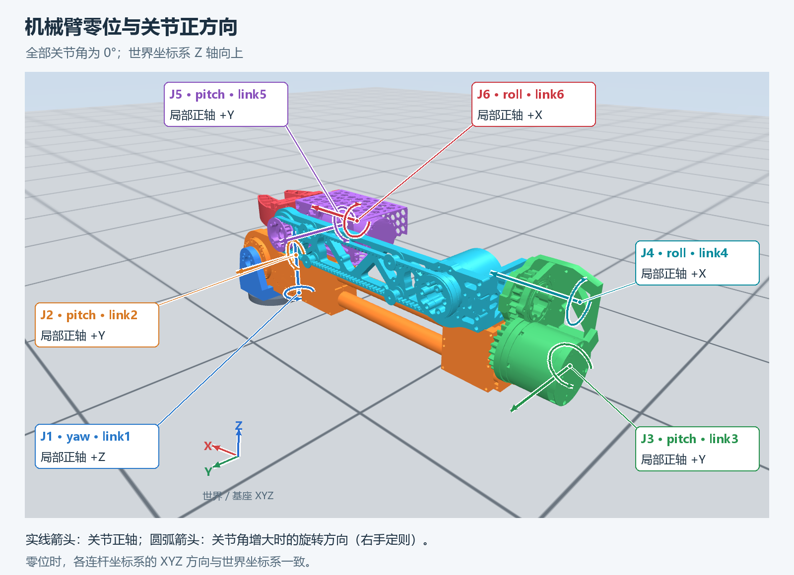

# 机械臂资产

包含 CAD 来源文件和 MuJoCo 3.9.0 模型，共七个实体连杆、六个转动关节，使用 SI 单位。质量、质心和惯量来自 CAD。

| 路径 | 用途 |
| --- | --- |
| `description/scene.xml` | MuJoCo 场景入口，包含机器人、地面、网格和照明 |
| `description/arm.xml` | 机器人定义，包含关节、惯量和六路力矩输入 |
| `description/robot.urdf` | CAD 导出的连杆、关节和惯量定义 |
| `meshes/mjcf/` | MJCF 使用的视觉和碰撞 STL |
| `meshes/urdf/` | URDF 使用的 CAD 来源视觉和碰撞 STL |
| [images/preview.png](images/preview.png) | CAD 装配预览图 |
| [images/zero_pose.png](images/zero_pose.png) | MJCF 模型零位与关节正方向示意图 |

MJCF 使用右手坐标系，世界 Z 轴向上，基座坐标系与世界坐标系重合。六轴角度均为 0 时，各连杆 XYZ 与世界 XYZ 方向一致。J1–J6 的局部正轴依次为 +Z、+Y、+Y、+X、+Y、+X，正角遵循右手定则。`tool0` 与 link6 原点重合，作为末轴参考。

基座固定，总质量约 4.62064 kg。仿真步长为 1 ms，重力为 `(0, 0, -9.81) m/s²`。

`motor1`–`motor6` 对应 `joint1`–`joint6`，接受关节力矩输入（N·m）。运动范围和输出力矩范围如下：

| 关节 | 角度范围（rad） | 角度范围（deg） | 力矩范围（N·m） |
| --- | --- | --- | --- |
| J1 | −7π/6 ～ π/6 | −210 ～ 30 | ±20 |
| J2 | 0 ～ 5π/6 | 0 ～ 150 | ±80 |
| J3 | −5π/6 ～ 0 | −150 ～ 0 | ±20 |
| J4 | −π ～ π | −180 ～ 180 | ±10 |
| J5 | −π/2 ～ π/2 | −90 ～ 90 | ±10 |
| J6 | −π ～ π | −180 ～ 180 | ±2 |

仿真包含地面接触和机械臂自碰撞。

查看、检查和导入命令见 [Python 工具说明](../tools/python/README.md)。
