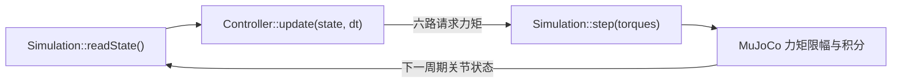

# 架构说明

## 模块职责

| 模块 | 职责 |
| --- | --- |
| [app](../app/) | 启动程序，处理运行与复位操作，调度控制和物理步进，组织界面 |
| [core](../core/) | GLFW 窗口、输入事件、MuJoCo 场景渲染和相机操作 |
| [simulation](../simulation/) | 管理 MuJoCo 模型和数据，将关节反馈与力矩输入映射到引擎 |
| [simulation/arm](../simulation/arm/) | 定义机械臂输入输出类型，提供成员控制器 |
| [assets](../assets/README.md) | 定义机器人几何、惯量、关节、驱动和接触参数 |
| [tools](../tools/README.md) | 提供构建、运行和离线模型工具 |

`Application` 持有 `Simulation`、`Controller`、`Window`、`Renderer` 和 `Ui`。控制器仅依赖机械臂数据类型；仿真封装负责读取反馈和施加力矩，由 `Application` 连接两者。

模型和 OpenGL 上下文的生命周期覆盖渲染资源：`Simulation` 先于渲染器创建，`Window` 先于 `Renderer` 和 `Ui` 创建，析构按相反顺序进行。

## 控制周期与接口

每个物理周期由 `Application` 按以下数据流调用：

[types.hpp](../simulation/arm/types.hpp) 定义共享输入输出，数组下标 0–5 对应 J1–J6：

| 类型 / 字段 | 含义 | 单位 |
| --- | --- | --- |
| `JointState::time` | 仿真时间 | s |
| `JointState::position` | 六轴关节角度 | rad |
| `JointState::velocity` | 六轴关节角速度 | rad/s |
| `JointTorques` | 六轴关节力矩 | N·m |

[Controller](../simulation/arm/controller.hpp) 提供 `update(const JointState &state, double dt)` 和 `reset()`。`update` 每个物理步调用一次，`dt` 来自模型步长，单位为 s；返回请求力矩。默认实现返回六路零力矩。

[Simulation](../simulation/simulation.hpp) 按 `joint1`–`joint6`、`motor1`–`motor6` 的名称绑定引擎中的关节状态地址和执行器。`step` 写入全部六路控制量，执行一次 `mj_step`，再用 `mj_forward` 更新当前姿态和输出。

力矩限幅由 MJCF 的电机配置执行。`lastTorques()` 返回限幅后的实际电机输出，供 UI 显示。关节限位、重力和接触同样由 MuJoCo 根据模型计算，参数见 [资产说明](../assets/README.md)。

## 调度与复位

主循环在一个线程中处理输入、运行控制周期和渲染。`Application` 累计墙钟时间，每累计一个模型步长就完成一次控制计算和物理步进。当前步长为 1 ms，目标运行速度为 1×；一次渲染帧内可以执行多个物理周期。

- 启动时恢复 `zero` keyframe，调用控制器 `reset()`，保持暂停。
- 暂停时停止控制计算和物理步进，窗口及视角仍可操作。
- 切换运行状态、复位或最小化时清空时间积压。最小化期间停止推进，恢复窗口后继续原运行状态。
- 仿真复位恢复零位、零速度、零力矩和时间 0，同时重置控制器并暂停；相机保持当前视角。
- 相机复位仅调整视角。

## 显示

UI 先收集运行和复位操作，完成本帧物理周期后，再读取最新状态构建读数。渲染器使用同一份 MuJoCo 模型和数据绘制场景。

右侧面板按 Run、Joints、View 分区。关节角度和角速度在 UI 中转换为 deg 和 deg/s，控制接口始终使用 SI 单位。渲染默认隐藏碰撞几何，可显示各关节的坐标系。

面板宽度上限为 560，窗口缩小时优先保留 320 的场景宽度，面板内容可滚动。输入按场景和面板区域分流，面板操作由 UI 消费，场景拖动和滚轮操作交给相机。
