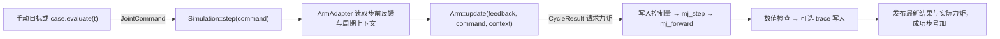

# 架构说明

## 模块职责

| 模块 | 职责 |
| --- | --- |
| [app](../app/) | 手动目标、启动选项和普通应用调度；`ui/` 提供手动控件及共用状态读数 |
| [benchmark](../benchmark/) | 工况定义与选择、Runner、启动选项及独立 GUI；`cases/` 按工况组织代码，`ui/` 组织运行面板 |
| [core](../core/) | GLFW 窗口、输入事件、MuJoCo 场景渲染和相机操作 |
| [simulation](../simulation/) | 持有模型、数据、ArmAdapter、Arm 和可选 TraceWriter，完成一次业务调用、物理步进及记录 |
| [simulation/arm](../simulation/arm/) | 定义机械臂输入输出类型，通过 Arm 入口执行机械臂业务并管理算法状态 |
| [assets](../assets/README.md) | 定义机器人几何、惯量、关节、驱动和接触参数 |
| [tools](../tools/README.md) | 提供构建、运行和离线模型工具 |

普通应用的 `Application` 持有唯一的手动 `JointCommand`、`Simulation`、`Window`、`Renderer` 和 `Ui`。UI 编辑目标，应用在每个物理周期调用 `Simulation::step(command)`。

Benchmark 的 `Runner` 持有选中的 `CaseSpec`、执行报告和当前 `Simulation`。每个 case 创建新的 Simulation 和 Arm。Benchmark GUI 持有窗口与渲染器，借用 Runner 的仿真数据；headless 直接循环调用同一个 Runner。两条入口使用同一条业务、物理和 trace 调用链。

模型和 OpenGL 上下文的生命周期覆盖渲染资源：`Simulation` 先于渲染器创建，`Window` 先于 `Renderer` 和 `Ui` 创建，析构按相反顺序进行。

Benchmark 切换 case 时先释放 Renderer，再由 Runner 销毁旧 Simulation，随后为新模型创建 Renderer；窗口和 OpenGL 上下文保持有效。普通 UI 不依赖 benchmark 类型，共用关节读数、视角操作和渲染实现。

## 控制周期与接口

普通应用和 benchmark 每个物理周期都通过以下调用链执行：



[types.hpp](../simulation/arm/types.hpp) 定义共享输入输出，数组下标 0–5 对应 J1–J6：

| 类型 / 字段 | 含义 | 单位 |
| --- | --- | --- |
| `JointCommand::position` | 六轴目标位置，仅零阶量 | rad |
| `JointFeedback::position` | 六轴步前位置 | rad |
| `JointFeedback::velocity` | 六轴步前速度 | rad/s |
| `ArmContext::time` | 步前仿真时间 | s |
| `ArmContext::dt` | 本次业务调用的模型步长 | s |
| `CycleResult::torques` | 六轴请求力矩，类型为 JointTorques | N·m |
| `CycleResult::torque_saturated` | 六轴力矩饱和标记 | bool |

[Arm](../simulation/arm/arm.hpp) 提供以下入口：

```cpp
CycleResult update(const JointFeedback &feedback,
                   const JointCommand &command,
                   const ArmContext &context);
void reset();
```

`update()` 每个物理步调用一次。输入目标、反馈、时间、dt 和返回力矩均为 float；模型时间及程序参考函数的时间参数保留 double。默认 Arm 返回六路零力矩，内部规划与控制由成员实现。

参考接入只传递目标位置，不补充目标速度或加速度，也不对程序参考裁剪或平滑。手动 UI 的位置范围来自模型；Simulation 入口统一拒绝非有限目标，有限的越界目标仍原样传入 Arm。

[ArmAdapter](../simulation/adapter.hpp) 按 `joint1`–`joint6`、`motor1`–`motor6` 绑定反馈地址和执行器，要求六个转动关节与六个对应电机。`Simulation::step()` 检查步前状态，读取反馈和上下文，调用 Arm，写入全部六路请求力矩，执行一次 `mj_step`，再用 `mj_forward` 更新当前姿态和输出。

`CycleResult::torques` 是 Arm 交给引擎的请求力矩，可能已经经过业务限幅。MJCF 电机配置仍可进一步限制输出；`lastTorques()` 返回引擎实际电机输出。关节限位、重力和接触同样由 MuJoCo 根据模型计算，参数见 [资产说明](../assets/README.md)。

Arm 在 `torque_saturated` 中报告业务侧饱和。Simulation 根据请求力矩与引擎实际输出的差异合并模型限幅状态，随成功周期结果一起发布，供共用 UI 读取。标记不影响控制计算，失败周期不发布新标记，Reset 清零。

数值检查和可选 trace 写入成功后，Simulation 才发布本周期 `CycleResult`、实际力矩并推进 `stepCount()`。Trace 复用本次调用的局部输入、反馈和结果，不重新生成参考。采样时点和字段见 [Benchmark 与采集](benchmark.md)。

非有限或不可表示的反馈、非有限力矩、MuJoCo 数值失败和非预期时间变化会使步进抛出异常，并清零控制输入。失败周期不发布新结果、不推进成功步号，已经推进的物理状态不回滚；应用终止本次执行，异常清理尽力刷新已有记录。

## 调度与复位

GUI 在一个线程中处理输入、控制周期和渲染。普通应用与 benchmark GUI 累计墙钟时间，每累计一个模型步长就执行一次完整物理周期。GUI 目标速度为 1×，一次渲染帧内可以执行多个周期。Headless 按计算速度推进 Runner，参考时间始终来自仿真。

- 每次创建 Simulation 时恢复模型的 `zero` keyframe 并调用 `Arm::reset()`。普通应用零目标、暂停启动；benchmark 自动开始。
- 暂停时停止控制计算和物理步进，窗口及视角仍可操作。
- 切换运行状态、复位或最小化时清空时间积压。最小化期间停止推进，恢复窗口后继续原运行状态。
- 普通应用 Reset 恢复零位、零速度、零力矩和时间 0，清空 Arm 状态及成功步数，将手动目标归零并暂停；相机保持当前视角。录制时先刷新，再进入新的复位段。
- Benchmark 通过取消结束本次实验，不提供 Reset 重跑。不同 case 使用各自的新 Simulation，进度读取 Simulation 的成功步数；执行细节见 [Benchmark 与采集](benchmark.md)。
- 相机复位仅调整视角。

## 显示与输入分流

UI 先收集运行和复位操作，完成本帧物理周期后，再读取最新状态构建读数。读取和显示不执行 Arm，也不额外求值 case 参考。渲染器使用同一份 MuJoCo 模型和数据绘制场景；物理数据不可显示时，benchmark 仅展示错误状态。

普通应用和 benchmark 共用关节读数与渲染，各自组织运行控制。输入按场景和面板区域分流，面板操作由 UI 消费，场景拖动和滚轮操作交给相机。窗口操作及读数含义见 [首页](../README.md#窗口操作)。
